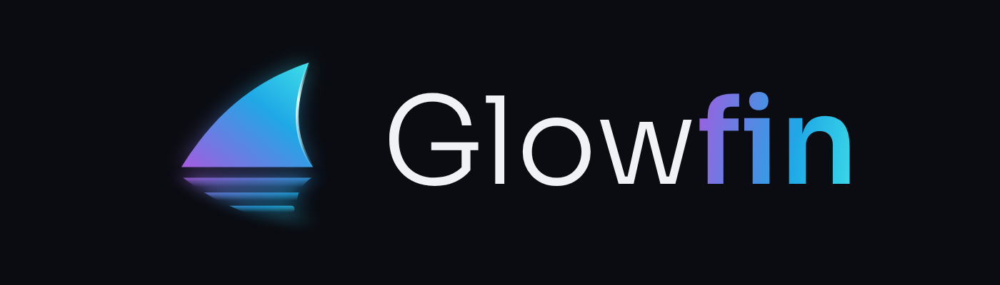
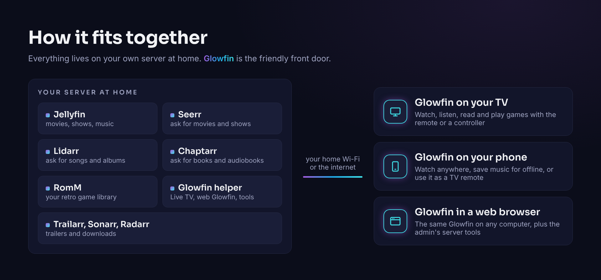
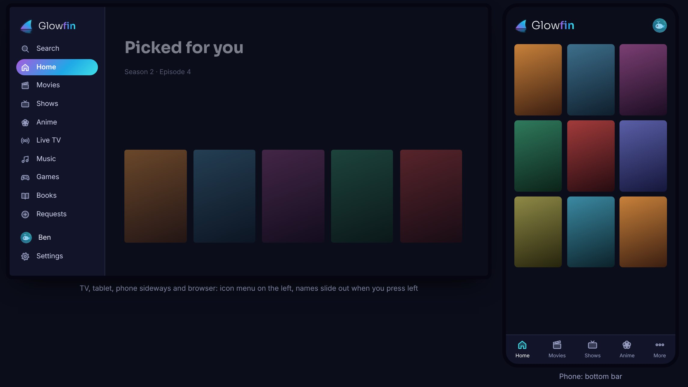
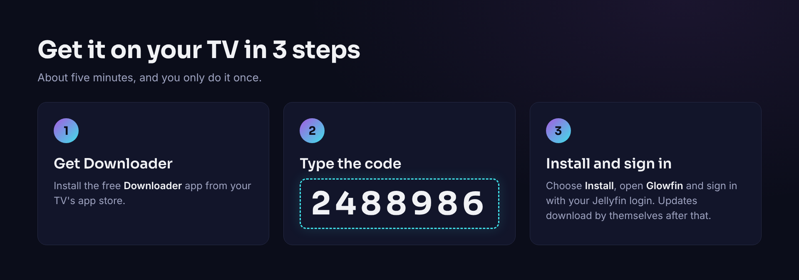

<p align="center">
  
</p>

<p align="center">
  <a href="https://github.com/TheBenPsych/MyStream/releases/tag/latest-build"></a>
  
  
</p>

<p align="center">
  <a href="#what-is-glowfin">What is it?</a> ·
  <a href="#the-new-look">The new look</a> ·
  <a href="#whats-inside">What's inside</a> ·
  <a href="#how-to-install">How to install</a> ·
  <a href="#for-the-server-admin">For the server admin</a> ·
  <a href="#credits-and-license">Credits</a>
</p>

## What is Glowfin?

Glowfin (formerly Benflix) is a home streaming app. It plays the movies, shows, anime and music you already keep
on your own [Jellyfin](https://jellyfin.org/) server, lets you read and listen to your books, adds live TV
channels, and plays your retro games right on the TV or phone.

It is a personal project for family and friends. It is not in the Google Play Store or the Amazon Appstore,
so you install it yourself. It takes about five minutes, see [How to install](#how-to-install).

Glowfin is built on top of the excellent open-source app [Wholphin](https://github.com/damontecres/Wholphin).
See [Credits and license](#credits-and-license).

<p align="center">
  
</p>

## The new look

Glowfin is getting a calmer, simpler design. It is quick to find your way around, and it stays smooth even on
slower TVs.

<p align="center">
  
</p>

- **Night-blue colours** with a purple-to-aqua glow, and clean, easy-to-read letters
- **One menu down the left side** on the TV, tablet and web browser: Search, Home, Movies, Shows, **Anime**, Live TV,
  Music, Games, Books, Requests, your picture and Settings. The names slide out when you press left.
- **On a phone**, a bar along the bottom: Home, Movies, Shows, Anime and **More** (everything else)
- **A soft glow ring** shows exactly what you're on. Nothing jumps or grows.
- A quiet start: the logo shows for a moment (no sounds), then **Who's watching?** with friendly
  **sea-friend pictures** for each profile
- Every page works the same way: a big picture of what you're on at the top, rows of posters below,
  and simple tabs like **For you**, **All movies**, **Genres** and **My List**

> [!NOTE]
> **The new look is being built one page at a time.** The colours, menu, glow and Who's watching are already in
> the app. The pages follow in this order: Movies, Shows, Anime and Home, then title pages, the video player,
> Settings, Requests, Live TV, Music, Books, Games and Kids. Until a page gets its turn it keeps its current layout.

## What's inside

<table>
<tr>
<td width="50%" valign="top">

### 🎬 Movies, Shows and Anime
- Tabs for **For you**, **All movies** or **All shows**, **Collections**, **Genres** and **My List**
- **Top 10** rows with big glowing numbers beside each poster
- Clean title pages with **IMDb** and **Rotten Tomatoes** scores, a trailer when you ask for it, and **More like this**
- **Ask for similar**: a row of similar titles you don't have yet, ready to ask for
- Shows list every season and episode, with "New episode" news on Home
- **Anime has its own spot** in the menu, with Dubbed and Subbed picks plus **AniList** and **MyAnimeList** scores

</td>
<td width="50%" valign="top">

### ▶️ Watching
- A clean player with clear **Subtitles**, **Audio**, **Episodes** and **Settings** buttons
- **Skip intro** and **Skip credits** that find the right spot by themselves
- The next episode plays by itself (you choose when it stops)
- **Subtitles are in English by default**, in one easy-to-read style everywhere
- A **Fix a problem** list in the player if the sound or picture acts up
- A **parents' guide** on every title
- Two video players (ExoPlayer and MPV) for the best subtitle support

</td>
</tr>
<tr>
<td width="50%" valign="top">

### 🎵 Music
- **Daily mixes** made for you, refreshed every morning
- Album, artist and playlist pages that look like movie pages
- A **Now playing** screen with **lyrics**
- **Save songs to your phone** to listen with no internet
- Bring in your playlists from **Spotify, YouTube Music** or **Deezer**
- **Ask for songs and albums**, and hear a **30 second preview** first

</td>
<td width="50%" valign="top">

### 📡 Live TV
- Hundreds of **real live channels**, sorted into types like News, Movies, Comedy and Kids
- **Recently watched** and a TV guide, with your favourites first
- Number keys to jump to a channel
- **Pause live TV**, and get a reminder before a big event starts

</td>
</tr>
<tr>
<td width="50%" valign="top">

### 🎮 Games
- Play your retro games **right on the TV or phone**, no streaming needed
- Over 20 game systems, from NES and Game Boy to PlayStation and arcade
- Play with the **TV remote**, a **Bluetooth controller**, or **your phone** as the game pad
- Save slots with pictures, and your saves follow you
- Movie puzzles, party games and scores to beat

</td>
<td width="50%" valign="top">

### 📚 Books
- **Read ebooks and comics**, and **listen to audiobooks**, right in Glowfin
- **Keep going** picks up where you stopped, in a book or an audiobook
- Top book lists with the books you have: best sellers, award winners and genre rows
- A **Want to read** list, and **Ask for it** for books you don't have yet

</td>
</tr>
<tr>
<td width="50%" valign="top">

### 🔎 Search and 🙋 Requests
- **One search for everything**: movies, shows, live channels, games and music, side by side
- Search in plain words, with your voice, or type on your phone
- Can't find it? **Ask for it** right from Search
- Ask for **movies, shows and anime** (powered by [Seerr](https://github.com/seerr-team/seerr)), **songs and albums**
  (powered by [Lidarr](https://lidarr.audio/)) or **books and audiobooks** (powered by Chaptarr)
- A **Top 10 to ask for**, Coming soon, Trending and genres
- **Your requests** shows where each one is in plain words, and Home tells you when it's ready

</td>
<td width="50%" valign="top">

### 👨‍👩‍👧 Profiles for everyone
- A friendly **Who's watching?** screen with sea-friend pictures, plus an optional PIN for each profile
- A **Kids** profile that only shows kid-friendly titles (rated PG or below), in its own bright look
- A **Guest** mode that saves nothing
- 👍 / 👎 likes, a **My watching** page with your stats, and your settings follow you to every device

</td>
</tr>
<tr>
<td width="50%" valign="top">

### 📱 Phone
- A touch-friendly phone layout with a bar along the bottom
- Use your phone as a **TV remote**, or send something to **Play on TV**
- **Sign in with my phone**: sign a new TV in by scanning a code or typing it on your phone

</td>
<td width="50%" valign="top">

### 🌐 Web Glowfin
- Open your server's address in **any web browser**, at home or away, no install needed
- The same menu, pages, player, music and requests as on the TV
- The admin's **Server page** and tools live here too

</td>
</tr>
</table>

And a few small touches: change any **poster** you don't like, a screensaver with artwork,
and Glowfin **updates itself** quietly in the background.

## How to install

> **You need:** a login for a Jellyfin server (ask whoever runs it), and a device with Android 6 or newer.

<p align="center">
  
</p>

### 📺 On a TV (Google TV, Android TV or Fire TV)

1. **Allow apps from "unknown sources"** on your TV, so it lets you install Glowfin. How-to guides:
   [Google TV / Chromecast](https://androidtvnews.com/unknown-sources-chromecast-google-tv/) ·
   [Fire TV](https://www.aftvnews.com/how-to-enable-apps-from-unknown-sources-on-an-amazon-fire-tv-or-fire-tv-stick/)
2. Install the free **Downloader** app from your TV's app store.
3. Open Downloader, type the code **`2488986`** and press **Go**.
4. When it finishes downloading, choose **Install**.
5. Open Glowfin. At home it finds your server by itself; otherwise type the server address, then sign in.
   (Already signed in on your phone? Use **Sign in with my phone** instead of typing your password.)

> [!NOTE]
> The newest Fire TV sticks that run **Vega OS** can't install outside apps, so Glowfin won't work on them.
> Older Fire TV sticks and Fire TV Cubes are fine.

### 📱 On an Android phone

1. On your phone, open [aftv.news/2488986](https://aftv.news/2488986) (or tap the **Download** badge at the top of this page and pick **Glowfin.apk**).
2. When it finishes downloading, tap it. If your phone asks, allow your browser to install apps.
3. Open Glowfin and sign in.

### 🌐 In a web browser

Open your server's address on port `8097` (ask whoever runs the server) in any web browser and sign in.
Nothing to install.

### 💻 On a computer (Linux, Steam Deck, Windows)

Glowfin has its own app for computers: its own window and icon, full screen with **F11**, and it finds your
server by itself at home.

- **Linux and Steam Deck:** download [Glowfin-linux.AppImage](https://github.com/thebenpsych/mystream/releases/download/desktop-latest/Glowfin-linux.AppImage),
  right-click it, open **Properties** and tick **Allow running as a program** (or "Is executable"), then double-click it.
  On a Steam Deck do this once in Desktop Mode, then right-click the file and pick **Add to Steam** so it
  shows up in Gaming Mode like a game.
- **Ubuntu, Mint, Debian:** download [Glowfin-linux.deb](https://github.com/thebenpsych/mystream/releases/download/desktop-latest/Glowfin-linux.deb) and double-click it to install.
- **Windows:** download [Glowfin-win.exe](https://github.com/thebenpsych/mystream/releases/download/desktop-latest/Glowfin-win.exe) and run it.
  Windows may say it doesn't know the app: pick **More info**, then **Run anyway**.

Everything inside the app comes straight from your server, so new features show up by themselves. The app
itself also keeps itself up to date.

### 🔄 Getting updates

You only install Glowfin once. New versions download quietly in the background. When one is ready, a dot
shows on your picture; open your picture's menu and pick **Help and updates** to see what's new and
install it in one click.

### 🍎 iPhone and Apple TV

There is no Apple app. iPhone users can open **web Glowfin** in Safari, or use
[Swiftfin](https://github.com/jellyfin/Swiftfin) or [Infuse](https://firecore.com/infuse) to watch from the same Jellyfin server.

## For the server admin

If you run the server, Glowfin has a few extra tools that only admins see:

- **Server page** in the app and in web Glowfin: who's watching, your libraries, downloads, problems and chores,
  with fix-it buttons, a **Glowfin versions** list for every TV and phone, and a way to send a message to one person
- **Waiting for you**: requests to approve or decline, for movies, shows, music and books
- **Poster fixer** to swap bad posters one at a time
- **Delete and find again** for a bad copy of a song
- Send a **note** that shows on Home, and pick the town for the **Home weather** (Server > Tools)

**What the server needs:**

| | Needed for | |
|---|---|---|
| [Jellyfin](https://jellyfin.org/) (version 12 recommended) | Everything | Required |
| Glowfin helper (in the [`server`](server) folder) | Games, Live TV, Books, web Glowfin, Skip intro, music extras, Home weather | Recommended |
| [Seerr / Jellyseerr](https://github.com/seerr-team/seerr) | Asking for movies and shows | Optional |
| [Lidarr](https://lidarr.audio/) | Asking for music | Optional |
| Chaptarr (a Readarr-style book downloader) | Asking for books and audiobooks | Optional |
| [RomM](https://github.com/rommapp/romm) | Your game library | Optional |
| [Trailarr](https://github.com/nandyalu/trailarr) | Trailers on title pages | Optional |

To set up (or update) the Glowfin helper, run this in the Unraid terminal (**Tools > Terminal**). It's safe to run again any time:

```bash
curl -fsSL https://raw.githubusercontent.com/TheBenPsych/MyStream/main/server/benflix-games-helper-setup.sh | bash
```

## Credits and license

Glowfin is a modified version (a "fork") of **[Wholphin](https://github.com/damontecres/Wholphin)** by
[damontecres](https://github.com/damontecres), an open-source Android TV app for Jellyfin.
A huge thank you to Wholphin and its contributors. Most of the hard work under the hood is theirs.
If you want a polished Jellyfin app from the Play Store, go get Wholphin!

Thanks also to:
- The [Jellyfin](https://jellyfin.org/) team for the media server
- The official [Jellyfin Android TV](https://github.com/jellyfin/jellyfin-androidtv) app, which some of Wholphin's playback code is adapted from
- The [Jellyfin Kotlin SDK](https://github.com/jellyfin/jellyfin-sdk-kotlin), [RomM](https://github.com/rommapp/romm), [Seerr](https://github.com/seerr-team/seerr), [Lidarr](https://lidarr.audio/), [Open Library](https://openlibrary.org/), [AniList](https://anilist.co/), [iptv-org](https://github.com/iptv-org/iptv) and all the other open-source projects this app uses

Glowfin is not connected to, or endorsed by, Netflix, Jellyfin or Wholphin.

### License

Like Wholphin, Glowfin is released under the **GNU General Public License, version 2** (GPL-2.0).
The full text is in the [LICENSE](LICENSE) file. In short: you are free to use, change and share this
app, but if you share a changed version you must share its source code under the same license
and keep these credits.

## For developers

Glowfin is built automatically by GitHub Actions every time a change lands on `main`. The newest APK
is always on the [latest-build release](https://github.com/TheBenPsych/MyStream/releases/tag/latest-build).
Every build is also checked for code that would crash on older TVs and phones, and a test robot clicks
through the main screens on a TV and a phone emulator.
For build details, see [DEVELOPMENT.md](DEVELOPMENT.md) (written for Wholphin, mostly still accurate).
The pictures on this page live in [`docs/readme`](docs/readme).
