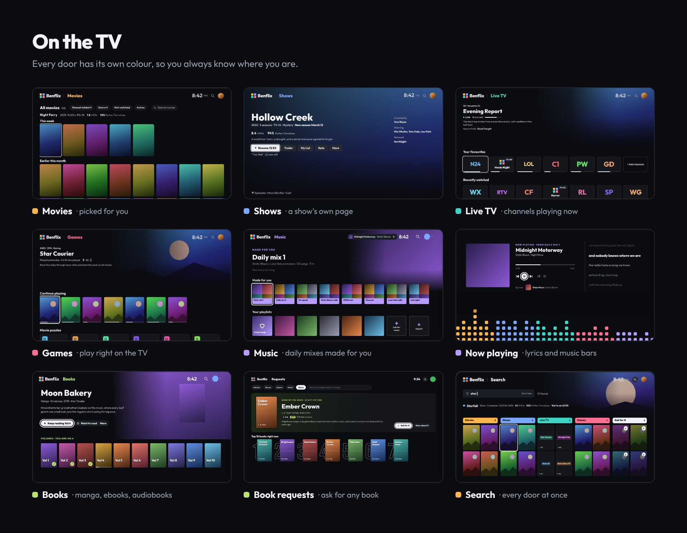
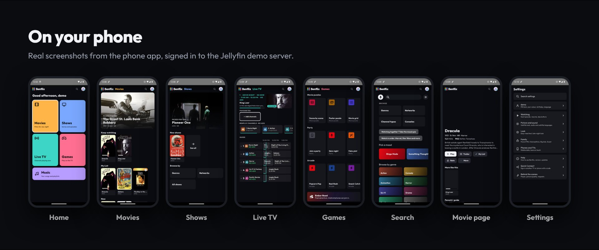

<p align="center">
  
</p>

<p align="center">
  <a href="https://github.com/TheBenPsych/MyStream/releases/tag/latest-build"></a>
  
  
</p>

<p align="center">
  <a href="#what-is-benflix">What is it?</a> ·
  <a href="#a-quick-look">A quick look</a> ·
  <a href="#whats-inside">What's inside</a> ·
  <a href="#how-to-install">How to install</a> ·
  <a href="#for-the-server-admin">For the server admin</a> ·
  <a href="#credits-and-license">Credits</a>
</p>

## What is Benflix?

Benflix is a home streaming app. It plays the movies, shows and music you already keep on your own
[Jellyfin](https://jellyfin.org/) server, lets you read and listen to your books, adds live TV channels,
and plays your retro games right on the TV or phone.

Everything sits behind **six coloured doors**: 🟧 **Movies**, 🟦 **Shows**, 🟩 **Live TV**, 🟥 **Games**, 🟪 **Music**
and 🟨 **Books**. Each door keeps its colour everywhere inside it, so you always know where you are.

Beside the doors, Home shows **a short list of your news**: a new episode of a show you watch, a request that's
ready, something on its way, or a fun fact, plus today's weather. Clear any line with an **X**, or all of them with **Clear all**.

It is a personal project for family and friends. It is not in the Google Play Store or the Amazon Appstore,
so you install it yourself. It takes about five minutes, see [How to install](#how-to-install).

Benflix is built on top of the excellent open-source app [Wholphin](https://github.com/damontecres/Wholphin).
See [Credits and license](#credits-and-license).

<p align="center">
  
</p>

## A quick look

<p align="center">
  
</p>

<p align="center">
  
</p>

<sub>The phone pictures are real screenshots, taken by the test robot on the public Jellyfin demo server
(from before the Books door arrived). The TV pictures come from the finished Benflix design, with made-up titles.</sub>

## What's inside

<table>
<tr>
<td width="50%" valign="top">

### 🟧 Movies and 🟦 Shows
- Each door opens on a big **Picked for you** banner, then **Keep watching**, **My List**, **Top 10**, collections and more
- Clean title pages with **IMDb** and **Rotten Tomatoes** scores, a trailer that fades in, and **More like this**
- **Did you know?** fun facts on hundreds of movie and show pages
- **Ask for more like this**: a row of similar titles you don't have yet, ready to ask for
- Can't decide? **This or that** and the **Mood quiz** at the bottom of Movies and Shows pick something for you
- Shows list every season and episode, with "New episode" news on Home
- Anime gets its own picks, Dubbed and Subbed, plus **AniList** and **MyAnimeList** scores
- An **All movies** and **All shows** grid you can sort by newest, A to Z or year

</td>
<td width="50%" valign="top">

### ▶️ Watching
- A clean player with **Skip intro** and **Skip credits** that find the right spot by themselves
- The next episode plays by itself (you choose when it stops)
- **Subtitles are in English by default**, everywhere, and they move out of the way of on-screen words
- A **parents' guide** on every title
- Two video players (ExoPlayer and MPV) for the best subtitle support

</td>
</tr>
<tr>
<td width="50%" valign="top">

### 🟪 Music
- **Daily mixes** made for you, refreshed every morning
- Album, artist and playlist pages that look like movie pages
- A **Now playing** screen with **lyrics** and colourful music bars
- **Save songs to your phone** to listen with no internet
- Bring in your playlists from **Spotify, YouTube Music** or **Deezer**, or just the songs
- **Ask for songs and albums**, and hear a **30 second preview** first
- Music also plays in Benflix in your web browser

</td>
<td width="50%" valign="top">

### 🟩 Live TV
- About **600 hand-picked channels**, sorted into types like News, Movies, Comedy, Kids and Holiday
- **Benflix channels** with no ads, built from your own movies and shows, and you can **make your own channel**
- Favourites, a TV guide, and number keys to jump to a channel
- **Pause live TV**, and get a reminder before a big event starts

</td>
</tr>
<tr>
<td width="50%" valign="top">

### 🟥 Games
- Play your retro games **right on the TV or phone**, no streaming needed
- Over 20 game systems, from NES and Game Boy to PlayStation and arcade
- Play with the **TV remote**, a **Bluetooth controller**, or **your phone** as the game pad
- Save slots with pictures, and your saves follow you
- Party games like **Quiz night**, movie puzzles, leaderboards and the **Ember Road** pixel adventure

</td>
<td width="50%" valign="top">

### 🔎 Search and 🙋 Requests
- **One search for everything**: movies, shows, live channels, games and music, side by side
- Search in plain words, or with your voice, or type on your phone
- Can't find it? **Ask for it** right from Search
- Ask for **movies, shows and anime** (powered by [Seerr](https://github.com/seerr-team/seerr)), **songs, albums and playlists** (powered by [Lidarr](https://lidarr.audio/)) or **books and audiobooks** (powered by Chaptarr)
- Requests pages with a **Top 10 to ask for this week**, genres, and a wall of posters
- See when it's on its way, and get told on Home when it's ready

</td>
</tr>
<tr>
<td width="50%" valign="top">

### 🟨 Books
- **Read manga, comics and ebooks**, and **listen to audiobooks**, right in Benflix
- Manga series show as one tile, with **Keep reading** on the next volume
- Books Home has **top lists with the books you have**: New York Times, Apple Books and Hardcover best sellers, award winners, genre rows, **Readers love these** and **Quick reads**
- A **Want to read** list, and Ask for it (or Ask Ben) for books you don't have yet
- Book requests with a **Book of the week**, a Top 10, best seller lists, genres and a page for every book, in English

</td>
<td width="50%" valign="top">

### 🌐 Web Benflix
- Open your server's address in **any web browser**, at home or away, no install needed
- The same six doors, player, music, requests and settings as on the TV
- Now caught up with the TV and phone: **Ask for more like this**, the parents' guide, anime extras, game roulette and more
- The admin's **Server page** and tools live here too

</td>
</tr>
<tr>
<td width="50%" valign="top">

### 👨‍👩‍👧 Profiles for everyone
- A friendly **Who's watching?** screen and a short startup intro where the doors grow out of the logo
- Fun avatars on a colour you pick, plus an optional PIN for each profile
- A **Kids** profile that only shows kid-friendly titles, and an **Easy mode** with bigger words
- 👍 / 👎 likes, a **My watching** page with your stats, and your settings follow you to every device

</td>
<td width="50%" valign="top">

### 📱 Phone
- A touch-friendly phone layout, with the same six doors
- Use your phone as a **TV remote**, or send something to **Play on TV**
- **Quick Connect**: sign a new TV in by typing its code on your phone
- Save songs to listen with no internet

</td>
</tr>
</table>

And a few small touches: change any **poster** you don't like, a screensaver with artwork and fun facts,
and Benflix **updates itself** quietly in the background.

## How to install

> **You need:** a login for a Jellyfin server (ask whoever runs it), and a device with Android 6 or newer.

<p align="center">
  
</p>

### 📺 On a TV (Google TV, Android TV or Fire TV)

1. **Allow apps from "unknown sources"** on your TV, so it lets you install Benflix. How-to guides:
   [Google TV / Chromecast](https://androidtvnews.com/unknown-sources-chromecast-google-tv/) ·
   [Fire TV](https://www.aftvnews.com/how-to-enable-apps-from-unknown-sources-on-an-amazon-fire-tv-or-fire-tv-stick/)
2. Install the free **Downloader** app from your TV's app store.
3. Open Downloader, type the code **`2488986`** and press **Go**.
4. When it finishes downloading, choose **Install**.
5. Open Benflix. At home it finds your server by itself; otherwise type the server address, then sign in.
   (Already signed in on your phone? Use **Sign in with my phone** instead of typing your password.)

> [!NOTE]
> The newest Fire TV sticks that run **Vega OS** can't install outside apps, so Benflix won't work on them.
> Older Fire TV sticks and Fire TV Cubes are fine.

### 📱 On an Android phone

1. On your phone, open [aftv.news/2488986](https://aftv.news/2488986) (or tap the **Download** badge at the top of this page and pick **Benflix.apk**).
2. When it finishes downloading, tap it. If your phone asks, allow your browser to install apps.
3. Open Benflix and sign in.

### 🌐 In a web browser

Open your server's address on port `8097` (ask whoever runs the server) in any web browser and sign in.
Nothing to install.

### 🔄 Getting updates

You only install Benflix once. New versions download quietly in the background. When one is ready, a dot
shows on your picture; open your picture's menu and pick **Help and updates** to see what's new and
install it in one click.

### 🍎 iPhone and Apple TV

There is no Apple app. iPhone users can open **web Benflix** in Safari, or use
[Swiftfin](https://github.com/jellyfin/Swiftfin) or [Infuse](https://firecore.com/infuse) to watch from the same Jellyfin server.

## For the server admin

If you run the server, Benflix has a few extra tools that only admins see:

- **Server page** in the app and in web Benflix: who's watching, your libraries, downloads, problems and chores,
  with fix-it buttons, a **Benflix versions** list for every TV and phone, and a way to send a message to one person
- **Requests** to approve or decline, for movies, shows, music and books
- **Poster fixer** to swap bad posters one at a time
- **Delete and find again** for a bad copy of a song
- Send a **note** that shows on Home, and pick the town for the **Home weather** (Server > Tools)

**What the server needs:**

| | Needed for | |
|---|---|---|
| [Jellyfin](https://jellyfin.org/) (version 12 recommended) | Everything | Required |
| Benflix helper (in the [`server`](server) folder) | Games, Live TV, Books, web Benflix, Skip intro, music extras, fun facts, Home weather | Recommended |
| [Seerr / Jellyseerr](https://github.com/seerr-team/seerr) | Asking for movies and shows | Optional |
| [Lidarr](https://lidarr.audio/) | Asking for music | Optional |
| Chaptarr (a Readarr-style book downloader) | Asking for books and audiobooks | Optional |
| [RomM](https://github.com/rommapp/romm) | Your game library | Optional |
| [Trailarr](https://github.com/nandyalu/trailarr) | Trailers on title pages | Optional |

To set up (or update) the Benflix helper, run this in the Unraid terminal (**Tools > Terminal**). It's safe to run again any time:

```bash
curl -fsSL https://raw.githubusercontent.com/TheBenPsych/MyStream/main/server/benflix-games-helper-setup.sh | bash
```

## Credits and license

Benflix is a modified version (a "fork") of **[Wholphin](https://github.com/damontecres/Wholphin)** by
[damontecres](https://github.com/damontecres), an open-source Android TV app for Jellyfin.
A huge thank you to Wholphin and its contributors. Most of the hard work under the hood is theirs.
If you want a polished Jellyfin app from the Play Store, go get Wholphin!

Thanks also to:
- The [Jellyfin](https://jellyfin.org/) team for the media server
- The official [Jellyfin Android TV](https://github.com/jellyfin/jellyfin-androidtv) app, which some of Wholphin's playback code is adapted from
- The [Jellyfin Kotlin SDK](https://github.com/jellyfin/jellyfin-sdk-kotlin), [RomM](https://github.com/rommapp/romm), [Seerr](https://github.com/seerr-team/seerr), [Lidarr](https://lidarr.audio/), [Open Library](https://openlibrary.org/), [AniList](https://anilist.co/), [iptv-org](https://github.com/iptv-org/iptv) and all the other open-source projects this app uses

Benflix is not connected to, or endorsed by, Netflix, Jellyfin or Wholphin.

### License

Like Wholphin, Benflix is released under the **GNU General Public License, version 2** (GPL-2.0).
The full text is in the [LICENSE](LICENSE) file. In short: you are free to use, change and share this
app, but if you share a changed version you must share its source code under the same license
and keep these credits.

## For developers

Benflix is built automatically by GitHub Actions every time a change lands on `main`. The newest APK
is always on the [latest-build release](https://github.com/TheBenPsych/MyStream/releases/tag/latest-build).
Every build is also checked for code that would crash on older TVs and phones, and a test robot clicks
through every screen on a TV and a phone emulator.
For build details, see [DEVELOPMENT.md](DEVELOPMENT.md) (written for Wholphin, mostly still accurate).
The pictures on this page live in [`docs/readme`](docs/readme).
