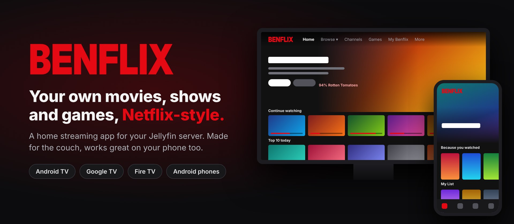
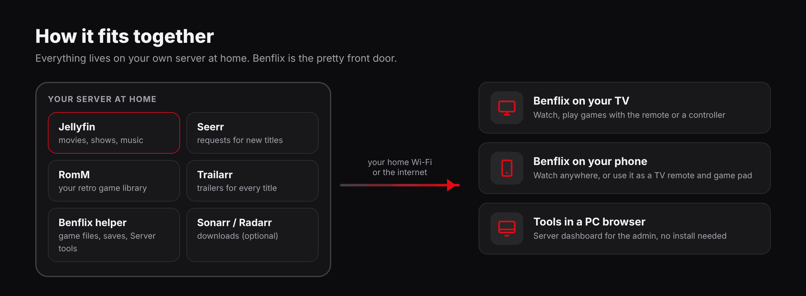
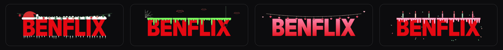
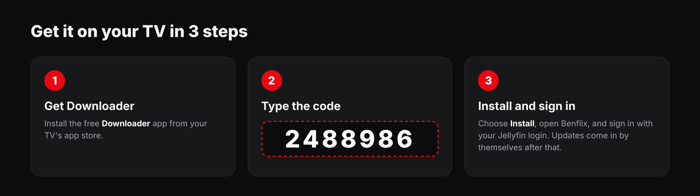

<p align="center">
  
</p>

<p align="center">
  <a href="https://github.com/TheBenPsych/MyStream/releases/tag/latest-build"></a>
  
  
</p>

<p align="center">
  <a href="#what-is-benflix">What is it?</a> ·
  <a href="#whats-inside">What's inside</a> ·
  <a href="#how-to-install">How to install</a> ·
  <a href="#for-the-server-admin">For the server admin</a> ·
  <a href="#credits-and-license">Credits</a>
</p>

## What is Benflix?

Benflix is a home streaming app. It plays the movies and shows you already keep on your own
[Jellyfin](https://jellyfin.org/) server, and makes them look and feel like a big streaming service.
It also plays your retro games right on the TV or phone.

It is a personal project for family and friends. It is not in the Google Play Store or the Amazon Appstore,
so you install it yourself. It takes about five minutes, see [How to install](#how-to-install).

Benflix is built on top of the excellent open-source app [Wholphin](https://github.com/damontecres/Wholphin).
See [Credits and license](#credits-and-license).

<p align="center">
  
</p>

## What's inside

<table>
<tr>
<td width="50%" valign="top">

### 🎬 Movies and shows
- A **Netflix-style Home** with a big rotating banner and a muted trailer behind it
- Rows for **Continue watching**, **Top 10**, seasonal picks, **Because you watched**, **Pick a mood**, **New on Benflix**, **My List**, collections, genres and studios
- **Browse** menu for Movies, Shows, Anime, Stand up and Music, each with its own mini Home
- **Rotten Tomatoes** scores, "New episode" badges and a **Surprise me** button
- Anime gets its own Top 10, Dubbed and Subbed tabs, and AniList scores

</td>
<td width="50%" valign="top">

### ▶️ Watching
- Netflix-style player with **Skip intro** and **Skip credits** (or always skip, per show)
- The next episode plays by itself
- Trailers play right inside the app
- Ambient mode when you pause
- Two video players (ExoPlayer and MPV) for the best subtitle support
- Optional **AniList** tracking for anime fans

</td>
</tr>
<tr>
<td width="50%" valign="top">

### 🎮 Games
- Play your retro games **right on the TV or phone**, no streaming needed
- Over 20 game systems, from NES and Game Boy to Nintendo 64 and arcade
- Play with the **TV remote**, a **Bluetooth controller**, or **your phone** as the game pad
- Three save slots with pictures, plus your saves follow you
- Watch a show in a small window **next to your game**
- High scores and leaderboards, including movie mini-games like Higher or Lower

</td>
<td width="50%" valign="top">

### 🙋 Requests
- Ask for a new movie or show from the **Requests** tab (powered by [Seerr](https://github.com/seerr-team/seerr))
- Pick just the seasons you want
- See when it's on its way, and get told if it can't be found
- The admin can **Approve** or **Decline** from the same page

</td>
</tr>
<tr>
<td width="50%" valign="top">

### 👨‍👩‍👧 Profiles for everyone
- **Who's watching?** screen with a wall of your own posters behind it
- Fun avatars, plus an optional PIN for each profile
- A **Kids** profile on every account that only shows kid-friendly titles
- 👍 / 👎 likes for each profile
- Your settings and profile picture follow you to every TV and phone

</td>
<td width="50%" valign="top">

### 📱 Phone extras
- A touch-friendly layout with a menu at the bottom
- **My Benflix** page with all your lists and settings
- Use your phone as a **TV remote**, or send something to **Play on TV**
- **Quick Connect**: sign a new TV in by typing its 6-digit code on your phone

</td>
</tr>
</table>

<p align="center">
  
</p>

And a few small touches: the logo dresses up for holidays and birthdays, there's a screensaver with
movie artwork and fun facts, and the app **updates itself**.

<p align="center">
  
</p>

## How to install

> **You need:** a login for a Jellyfin server (ask whoever runs it), and a device with Android 6 or newer.

<p align="center">
  
</p>

### 📺 On a TV (Google TV, Android TV or Fire TV)

1. **Allow apps from "unknown sources"** on your TV, so it lets you install Benflix. How-to guides:
   [Google TV / Chromecast](https://androidtvnews.com/unknown-sources-chromecast-google-tv/) ·
   [Fire TV](https://www.aftvnews.com/how-to-enable-apps-from-unknown-sources-on-an-amazon-fire-tv-or-fire-tv-stick/)
2. Install the free **Downloader** app from your TV's app store.
3. Open Downloader, type the code **`2488986`** and press **Go**.
4. When it finishes downloading, choose **Install**.
5. Open Benflix, type your Jellyfin server address, and sign in.
   (Already signed in on your phone? Use **Quick Connect** instead of typing your password.)

> [!NOTE]
> The newest Fire TV sticks that run **Vega OS** can't install outside apps, so Benflix won't work on them.
> Older Fire TV sticks and Fire TV Cubes are fine.

### 📱 On an Android phone

1. On your phone, open [aftv.news/2488986](https://aftv.news/2488986) (or tap the red **Download** badge at the top of this page and pick **Benflix.apk**).
2. When it finishes downloading, tap it. If your phone asks, allow your browser to install apps.
3. Open Benflix and sign in.

### 🔄 Getting updates

You only install Benflix once. When a new version is ready, a red **!** shows up on the **Settings** cog on TV
(or on **My Benflix** on your phone). Go to **Settings > Help > Install update** to see what's new and
install it in one click.

### 🍎 iPhone and Apple TV

There is no Apple version. Apple users can use [Swiftfin](https://github.com/jellyfin/Swiftfin) or
[Infuse](https://firecore.com/infuse) to watch from the same Jellyfin server.

## For the server admin

If you run the server, Benflix has a few extra tools that only admins see:

- **Server page** in the app: a dashboard of who's watching, your libraries, downloads, problems and chores, with
  fix-it buttons, a library scan button, and a way to send a pop-up message to one person
- **Tools in a PC browser** at your server's address on port `8097`, no install needed
- **Requests** to approve or decline, and "trending but missing" titles you could add

**What the server needs:**

| | Needed for | |
|---|---|---|
| [Jellyfin](https://jellyfin.org/) (version 12 recommended) | Everything | Required |
| [Seerr / Jellyseerr](https://github.com/seerr-team/seerr) | The Requests tab | Optional |
| [Trailarr](https://github.com/nandyalu/trailarr) | Trailers in the banner and on title pages | Optional |
| Intro Skipper plugin | Skip intro and Skip credits | Optional |
| [RomM](https://github.com/rommapp/romm) + the Benflix helper | Games | Optional |

The Benflix helper and other server scripts are in the [`server`](server) folder. To set up games, run this in
the Unraid terminal (**Tools > Terminal**):

```bash
curl -fsSL https://raw.githubusercontent.com/TheBenPsych/MyStream/main/server/benflix-games-helper-setup.sh | bash
```

## Credits and license

Benflix is a modified version (a "fork") of **[Wholphin](https://github.com/damontecres/Wholphin)** by
[damontecres](https://github.com/damontecres), an open-source Android TV app for Jellyfin.
A huge thank you to Wholphin and its contributors. Most of the hard work under the hood is theirs.
If you want a polished Jellyfin app from the Play Store, go get Wholphin!

Thanks also to:
- The [Jellyfin](https://jellyfin.org/) team for the media server
- The official [Jellyfin Android TV](https://github.com/jellyfin/jellyfin-androidtv) app, which some of Wholphin's playback code is adapted from
- The [Jellyfin Kotlin SDK](https://github.com/jellyfin/jellyfin-sdk-kotlin), [RomM](https://github.com/rommapp/romm), [Seerr](https://github.com/seerr-team/seerr) and all the other open-source projects this app uses

Benflix is not connected to, or endorsed by, Netflix, Jellyfin or Wholphin.

### License

Like Wholphin, Benflix is released under the **GNU General Public License, version 2** (GPL-2.0).
The full text is in the [LICENSE](LICENSE) file. In short: you are free to use, change and share this
app, but if you share a changed version you must share its source code under the same license
and keep these credits.

## For developers

Benflix is built automatically by GitHub Actions every time a change lands on `main`. The newest APK
is always on the [latest-build release](https://github.com/TheBenPsych/MyStream/releases/tag/latest-build).
Every build is also checked for code that would crash on older TVs and phones.
For build details, see [DEVELOPMENT.md](DEVELOPMENT.md) (written for Wholphin, mostly still accurate).
The pictures on this page live in [`docs/readme`](docs/readme).
